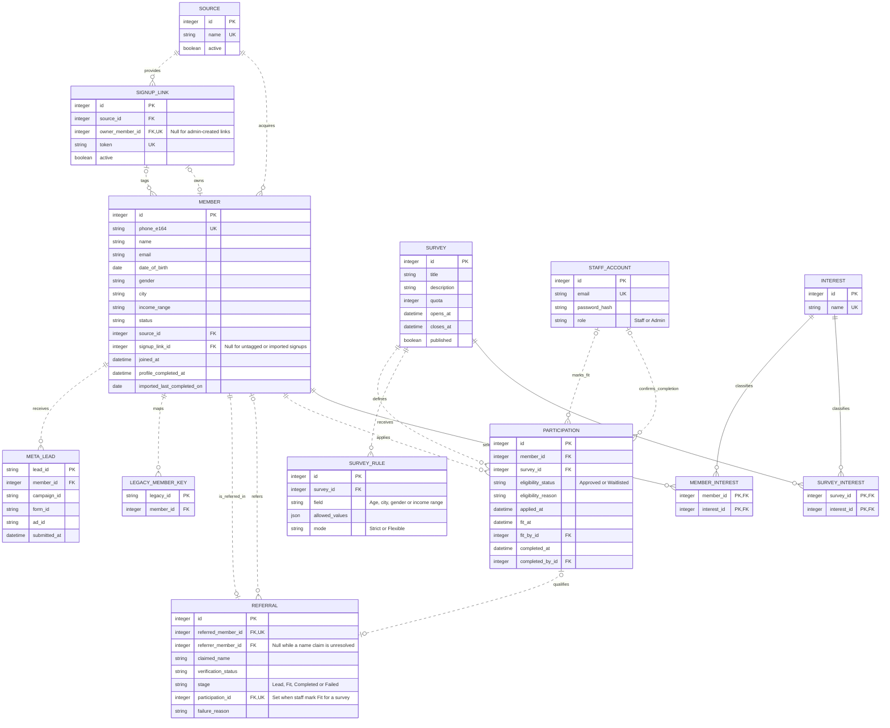

# Database diagram

ViewBox uses SQLite with SQLAlchemy. Each respondent has one member record. Acquisition, referrals, eligibility, and survey outcomes are tracked separately so staff can report on them without counting a person twice.

- **Signup and attribution.** Admins create named sources and unique link tokens in the database. Each source has one active admin link. A new member gets the source from the last tagged link used to reach signup, or selects an answer when no tag is present. A personal link also identifies the referring member. A name claim goes to staff for verification and does not modify the acquisition source. A member signs in by verifying their phone and completes missing profile details after login.
- **Surveys and quota.** `PARTICIPATION` is unique on `(member_id, survey_id)`. The detail page previews eligibility. Applying checks the rules again and reserves an approved place in the same database transaction as the quota check. Only published surveys within their dates are live. The window is at most 15 days. A strict rule failure, full quota, deadline, or active cool-off takes precedence over a flexible rule failure. Calculate the next eligible date as three calendar months after the latest completed participation or imported completion date, whichever is later. A shared interest highlights a survey without changing eligibility.
- **Fit and completion.** Staff record Fit on an approved participation and completion after the quality check. A verified referral starts at Lead. Once it reaches Fit, its linked participation must belong to the referred member. Only that participation can advance it to Completed. Failed referrals carry a reason. Member views show masked phone numbers. The source dashboard counts distinct members by original source, using recorded Fit and Completed milestones across their participations.
- **CSV and Meta leads.** Normalize phones before matching members. CSV rows with unusable phones are skipped, and the import reports fixed or skipped rows. Resolve `referred_by` values through unambiguous legacy IDs in a second pass. Use a Legacy Import source for missing CSV attribution and keep imported completion dates without creating survey participations. Meta validates a lead before saving it and stores campaign metadata against its unique lead ID. A retry returns the original result. New members get the Meta Ads source, while leads for existing phones preserve the member's original source.
