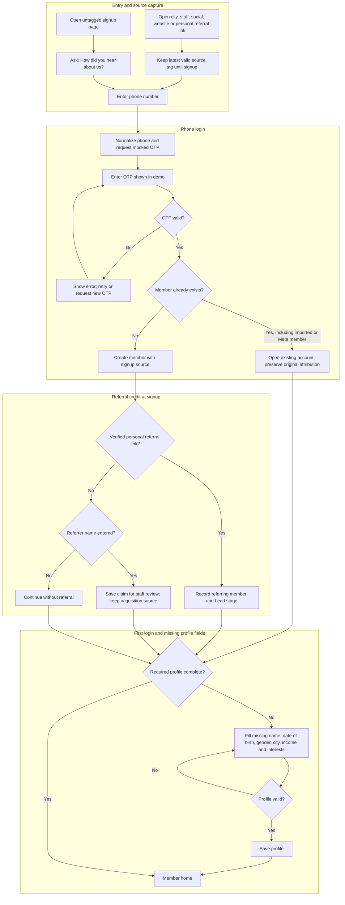
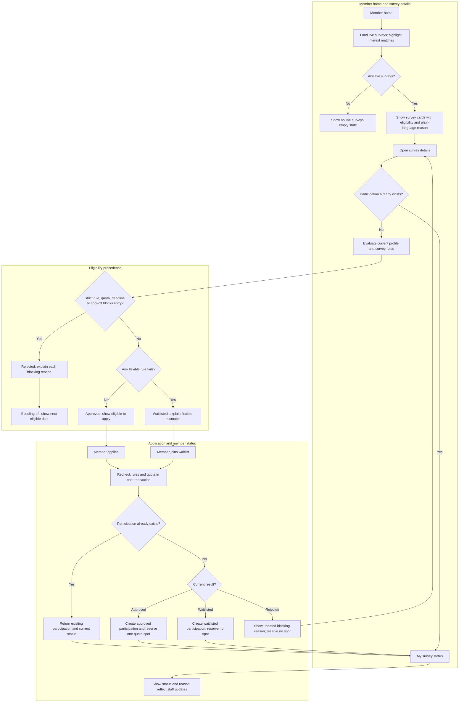
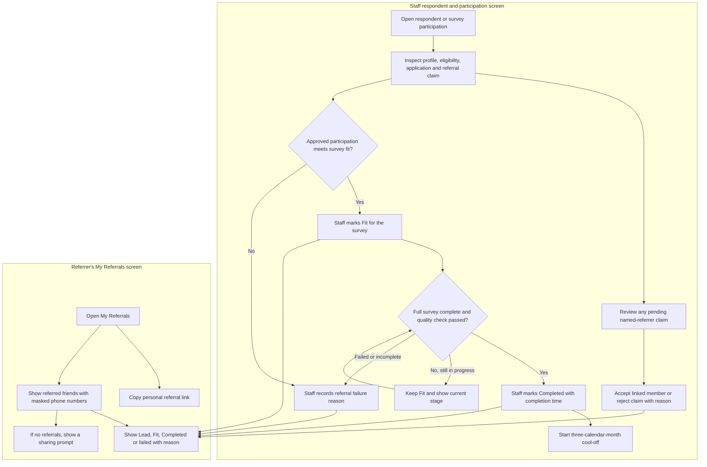
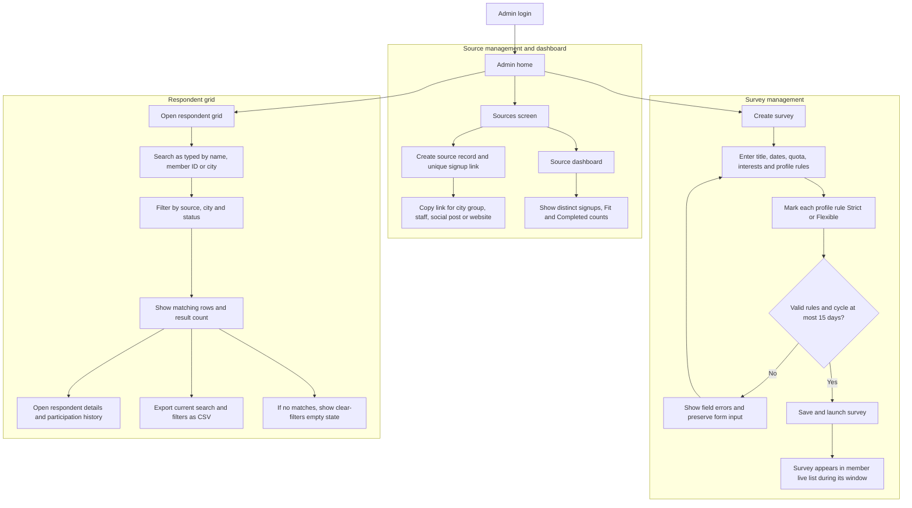
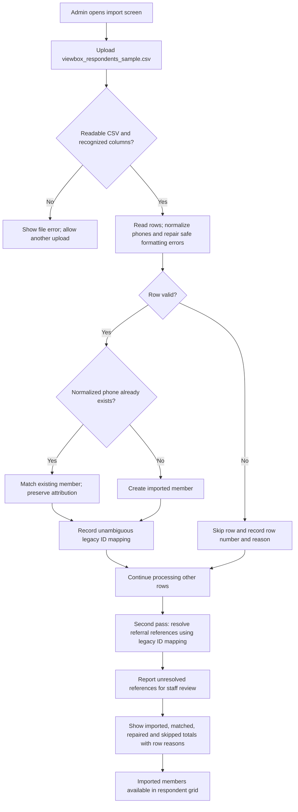
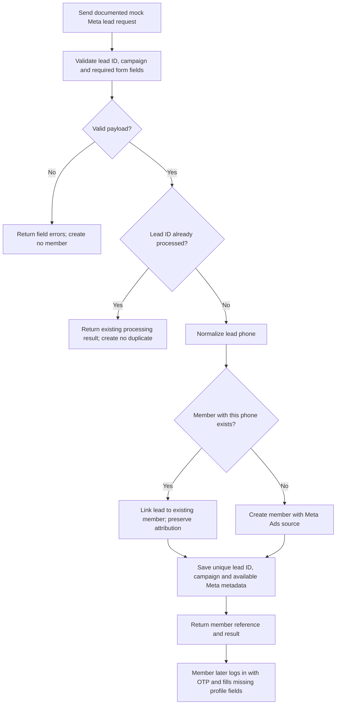

# ViewBox Panel System: user flow

Day 2 design baseline. Later design changes belong in new files so this submission remains intact.

The prototype uses FastAPI, SQLAlchemy and SQLite for the backend, and React, Vite, TypeScript and React Router for the mobile-first frontend. The local Vite proxy forwards API requests to FastAPI.

## 1. Member entry, attribution and profile

Acquisition source and referring member are separate records. The last valid tagged link present at signup determines a new member's acquisition source; an untagged signup requires the fallback answer. A verified referral link credits its owner automatically. A typed referrer name becomes a staff review claim and never replaces the acquisition source. Staff can resolve the claim to a member or reject it with a reason.

The source captured for an existing member is preserved when they log in later, including members created through CSV import or Meta Ads. Matching uses the normalized phone number. Existing members only complete missing profile fields.

## 2. Live surveys, eligibility and application

An eligibility preview does not reserve capacity. Only an eligible application reserves a quota spot. A member has at most one participation per survey; repeated submissions return the existing participation. The server rechecks eligibility and capacity when the application is submitted so a stale screen cannot exceed the quota.

Strict failures, a full quota, a reached deadline and the three-month cool-off block approval. A flexible mismatch produces Waitlisted only when there is no blocking condition. Interest matches highlight surveys but do not bypass eligibility rules. The cool-off ends three calendar months after a completed survey, and the member sees the exact date.

## 3. Staff milestones and member referral visibility

Lead means the referred member signed up. Staff marks Fit on an approved survey participation and marks Completed only after full participation and a successful quality check. The same actions update source reporting and the referral linked to that participation; each referral has at most one attributable participation. A failed referral exposes its plain-language reason to the referrer. Referred phone numbers are masked, for example `98XXXXXX21`. Referral success requires the Completed milestone.

## 4. Admin sources, surveys, respondent grid and export

Sources are editable database records, so adding a channel such as LinkedIn needs no code change. Every member also receives a personal referral link. Source/program stage counts use distinct members to avoid inflating results through repeated requests or multiple records. The exported dataset uses the same search and filter conditions as the visible grid.

Admin pages require the admin role. Staff actions require staff or admin access. Respondents can view only their own profile, applications and referral information.

## 5. Existing-member CSV import

Bad rows do not crash or abort the whole import. The result reports what was repaired or skipped and why. Legacy referral IDs are resolved after valid member rows have been processed, so a referral can point to a member appearing later in the file. Imported members subsequently access the same account through normalized-phone OTP login.

## 6. Mock Meta lead intake

The endpoint accepts a mock lead in the researched Meta lead format, retaining lead and campaign identifiers plus available form, ad and timestamp metadata. It validates required details and deduplicates on lead ID. A new lead with an existing phone attaches to the existing member without replacing that member's original acquisition source. The README will document the endpoint, an example request and its response so it can be exercised locally without a real ad.

## Shared screen states

- Data screens show a loading state, a useful empty state and a retryable load error.
- Forms retain entered values after validation errors and display field-specific messages.
- Application submission disables repeated taps while pending; the server enforces participation uniqueness and quota limits.
- Import and Meta errors include actionable reasons without exposing another member's private data.
